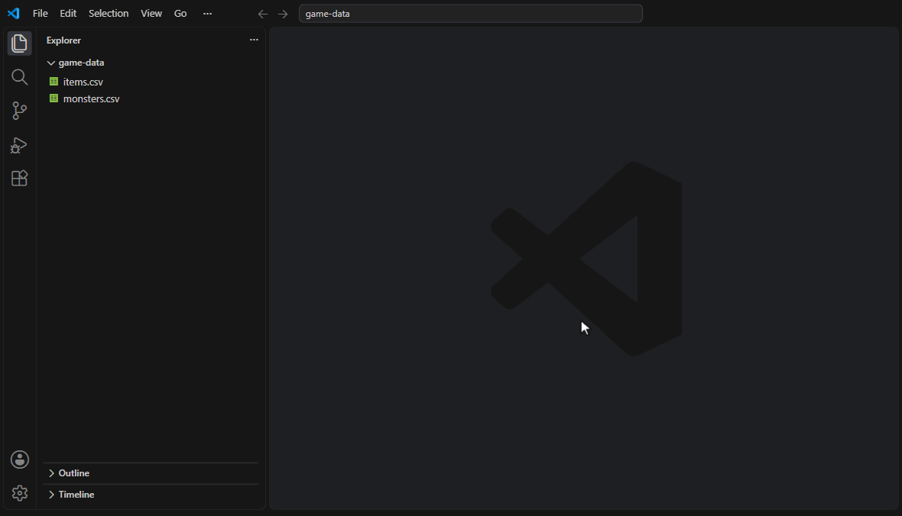
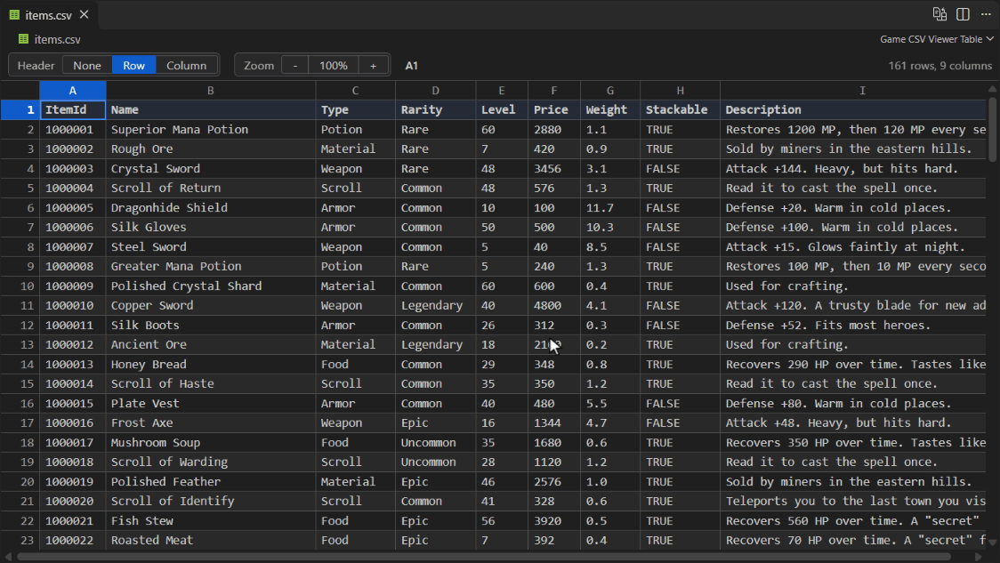
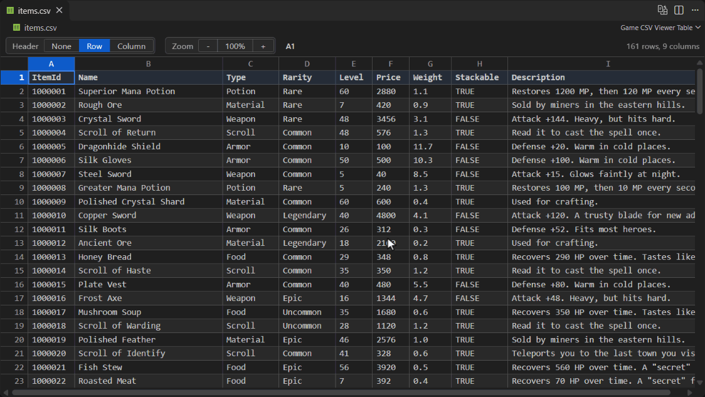
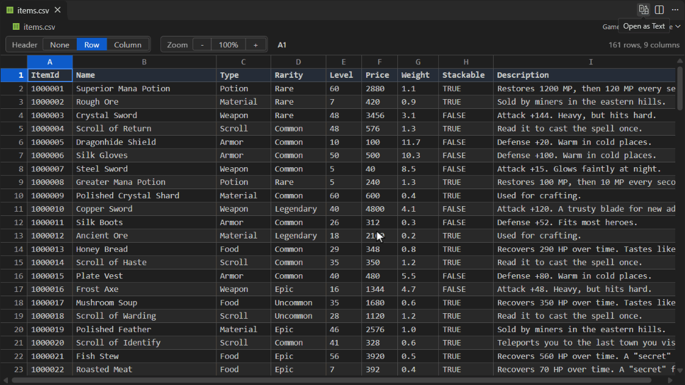
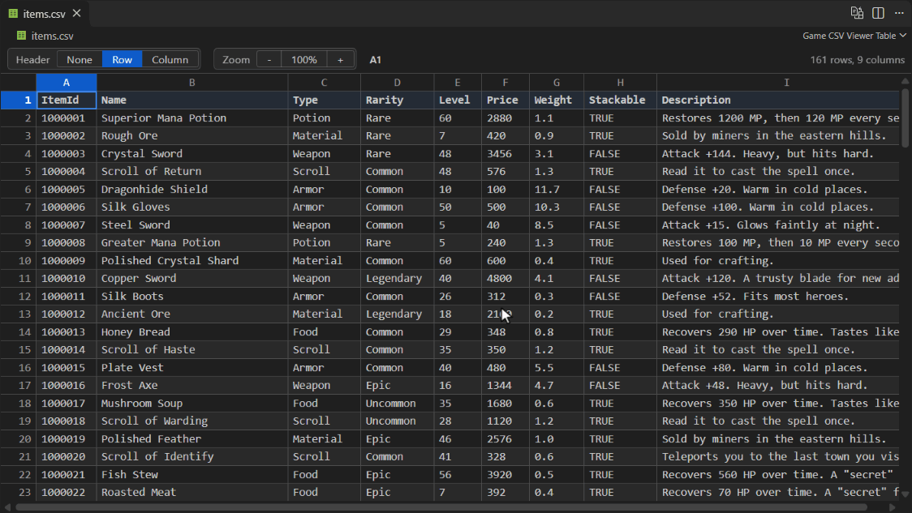
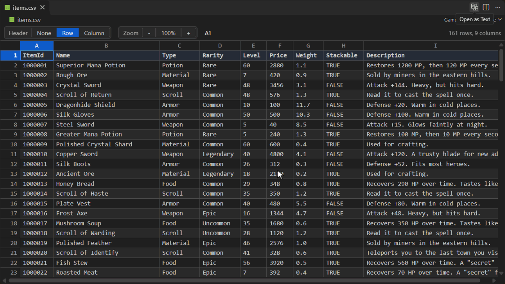

# Game CSV Viewer

**View and edit CSV and TSV files as a spreadsheet-style table in VS Code, without touching the rest of the file.**

Only the cells you change are rewritten, so quotes, line endings and every other cell stay exactly as they were, and your git diffs stay small.

> **Preview.** This extension is in early development. Please report problems on [GitHub Issues](https://github.com/sugyeongkimdev/vscode-game-csv-viewer/issues).

[한국어 설명은 아래에 있습니다.](#한국어)



## Why Game CSV Viewer

- **Minimal diffs.** Editing a cell replaces only that cell's text. Quotes are added only when a value needs them.
- **Works like a spreadsheet.** Click, Shift+click, Ctrl+click and drag to select; type to edit; Enter and Tab to move on.
- **Restructure in place.** Drag rows and columns to move them, and insert or delete several at once from the right-click menu.
- **One undo history.** Ctrl+Z undoes cell edits and column or row resizing in the order you made them.
- **Fast on large files.** Only the rows and columns on screen are drawn, and only changed rows are re-sent after an edit. Tested with a 10,000-row, 38-column file.
- **Local only.** No network access, no account, no telemetry.

## Getting started

1. Open a `.csv` or `.tsv` file. It opens in the normal text editor.
2. Click **Open as Table** (table icon) in the editor title bar, or right-click the file in the Explorer and choose **Open as Table**.
3. Click **Open as Text** to go back. The same tab switches between the two, and unsaved changes are kept.

To open CSV files as tables every time, set `gameCsvViewer.defaultEditor` to `table`. Even with the default (`text`), a CSV file you open while a table view is in front opens as a table too.

## Features

### Edit like a spreadsheet

Select a cell and type to replace it, or double-click (Enter, F2) to edit the existing value. Delete clears the selection, and Ctrl+Z brings it back.



### Copy and paste ranges

Ctrl+C copies the selection as tab-separated text and as an HTML table, the formats spreadsheet apps such as Google Sheets and Excel use. Ctrl+V pastes from the top-left cell of the selection. Pasting a single value into a selection fills every selected cell, and pasting past the end of the table adds rows and columns.


### Move rows and columns by dragging

Select whole rows or columns with their headers, then drag them. A floating box follows the mouse and a blue line shows where they will land.



### Insert and delete rows and columns

Right-click to insert or delete. With several rows or columns selected, the menu works on all of them, for example inserting two rows above two selected rows.


### Frozen header and zoom

Fix the first row or the first column in place, or neither. Stripes follow the header direction. Zoom with Ctrl+mouse wheel around the pointer, or with the `- | 100% | +` buttons. Zoom and sizes are remembered per file.



### Find

Ctrl+F searches every cell in the file, not just the rows on screen. Enter and Shift+Enter (or F3 and Shift+F3) move between matches.



### Resize, auto-fit and undo

Drag a column or row border to resize it. Double-click a column border to fit its content, or a row border to reset it. Sizes follow the content when you insert, delete or move rows and columns.



## Keyboard

| Key | Action |
|---|---|
| Type, Enter, F2 or double-click | Edit the cell (typing replaces the value) |
| Enter / Shift+Enter (while editing) | Confirm and move down / up |
| Tab / Shift+Tab | Confirm and move right / left |
| Alt+Enter (while editing) | New line inside the cell |
| Esc | Cancel editing, close Find, or shrink the selection to one cell |
| Arrow keys, Home, End, PageUp, PageDown | Move (with Ctrl: jump to the edge) |
| Shift + movement keys | Extend the selection |
| Delete, Backspace | Clear the selected cells |
| Ctrl+C, Ctrl+X, Ctrl+V | Copy, cut, paste |
| Ctrl+A | Select all |
| Ctrl+Z, Ctrl+Y (Ctrl+Shift+Z) | Undo, redo (including column and row sizes) |
| Ctrl+S | Save (the cell being edited is confirmed first) |
| Ctrl+F, then Enter / Shift+Enter (or F3 / Shift+F3) | Find, next / previous match |
| Ctrl+mouse wheel | Zoom in / out around the pointer |

## Settings

| Setting | Default | Description |
|---|---|---|
| `gameCsvViewer.defaultEditor` | `text` | How CSV and TSV files open: `text` (text editor) or `table` (table view). |
| `gameCsvViewer.headerMode` | `row` | Fixed header: `row` (first row), `column` (first column) or `none`. The toggle in the table view changes this setting. |
| `gameCsvViewer.language` | `auto` | Table view language: `auto` follows the VS Code display language (Korean if it is Korean, otherwise English), or `en`, `ko`. |

## Known limitations

- The delimiter comes from the file extension: comma for `.csv`, tab for `.tsv`. It is not detected automatically.
- Multi-line values are shown on one line with a return mark (↵). Edit the cell to see every line.
- There is no sorting or filtering yet.
- If the file changes outside the table (for example a git pull) while you are editing a cell, the edit is canceled instead of being written to a different row.
- A file that ends inside an unclosed quote is shown with a warning. Rows or columns added at its end go inside that quoted cell.

## Privacy

Game CSV Viewer works entirely inside VS Code. It does not make network requests, collect telemetry or need an account. Your files never leave your workspace.

## Development

```sh
npm install
npm run compile
npm test
```

`build.cmd` (Windows) compiles, packages a VSIX into `build/` and installs it into VS Code.

## License

[MIT](LICENSE)

---

## 한국어

**VS Code에서 CSV, TSV 파일을 스프레드시트 같은 표로 보고 고칩니다. 고친 셀의 글자만 바꾸고 나머지는 건드리지 않습니다.**

따옴표, 줄바꿈 모양, 고치지 않은 셀이 그대로 남아서 git 비교가 작게 나옵니다. 기능을 보여 주는 움직이는 그림은 위 영어 설명에 있습니다.

> **미리 보기 판입니다.** 아직 개발 중이라 문제가 있으면 [GitHub Issues](https://github.com/sugyeongkimdev/vscode-game-csv-viewer/issues)에 알려 주세요.

### 이런 점이 좋습니다

- **작은 변경**: 셀을 고치면 그 셀 글자만 바뀝니다. 따옴표는 값에 꼭 필요할 때만 붙입니다.
- **스프레드시트처럼**: 클릭, Shift+클릭, Ctrl+클릭, 끌어서 고르고, 바로 타자를 쳐서 고치고, Enter와 Tab으로 넘어갑니다.
- **표 모양 바꾸기**: 행과 열을 끌어서 옮기고, 오른쪽 버튼 메뉴로 여러 행, 열을 한 번에 넣고 지웁니다.
- **되돌리기 한 줄**: Ctrl+Z가 셀 고침과 열 너비, 행 높이 바꾼 것을 한 순서로 되돌립니다.
- **큰 파일도 빠르게**: 화면에 보이는 행과 열만 그리고, 고친 뒤에는 달라진 행만 다시 보냅니다. 1만 행 38열 파일로 시험했습니다.
- **내 컴퓨터 안에서만**: 네트워크 접속, 계정, 사용 정보 수집이 없습니다.

### 시작하기

1. `.csv`, `.tsv` 파일을 엽니다. 처음에는 보통 글자 편집기로 열립니다.
2. 편집기 제목 줄의 표 아이콘(**표로 열기**)을 누르거나, 탐색기에서 파일을 오른쪽 버튼으로 눌러 **표로 열기**를 고릅니다.
3. **텍스트로 열기**를 누르면 돌아갑니다. 같은 탭이 둘 사이를 오가고, 저장하지 않은 고침도 그대로입니다.

늘 표로 열려면 설정 `gameCsvViewer.defaultEditor`를 `table`로 바꿉니다. 기본값(`text`)이어도 표를 보고 있을 때 연 CSV는 표로 열립니다.

### 기능

- **고치기**: 셀을 고르고 타자를 치면 값을 바꾸고, 두 번 누르기(Enter, F2)는 원래 값 뒤에 이어 씁니다. Delete로 지우고 Ctrl+Z로 되돌립니다.
- **복사, 붙여 넣기**: Ctrl+C는 고른 범위를 탭으로 나눈 글자와 HTML 표로 함께 복사합니다(구글 시트, 엑셀 같은 스프레드시트가 쓰는 형식). 값 하나를 여러 셀에 붙이면 고른 셀이 모두 채워지고, 표 끝을 넘어 붙이면 행과 열이 늘어납니다.
- **행, 열 끌어 옮기기**: 행 번호나 열 이름으로 통째로 고른 뒤 끌면, 반투명 상자가 따라오고 파란 선이 놓을 자리를 보여 줍니다.
- **넣기, 지우기**: 오른쪽 버튼 메뉴입니다. 여러 행(열)을 골랐으면 그 개수만큼 넣고 모두 지웁니다.
- **머리글 고정과 확대**: 첫 행 또는 첫 열을 고정하고 그 방향으로 줄무늬를 칠합니다. Ctrl+휠은 마우스 자리를 기준으로, `- | 100% | +` 버튼은 지금 셀을 기준으로 확대, 축소합니다. 배율과 크기는 파일마다 기억합니다.
- **찾기**: Ctrl+F로 화면 밖 행까지 파일 전체를 찾고, Enter와 Shift+Enter(F3, Shift+F3)로 결과를 넘깁니다.
- **크기 조절**: 열, 행 경계를 끌어서 바꾸고, 열 경계를 두 번 누르면 내용에 맞춥니다. 행, 열을 넣거나 지우거나 옮기면 크기도 따라갑니다.

단축키는 위 영어 절의 표(Keyboard)와 같습니다. Ctrl+S는 고치던 셀을 먼저 확정한 뒤 저장합니다.

### 설정

- `gameCsvViewer.defaultEditor`: CSV, TSV를 열 때 쓸 편집기입니다. `text`(기본)는 글자 편집기, `table`은 표 화면입니다.
- `gameCsvViewer.headerMode`: 고정할 머리글입니다(`row` 첫 행, `column` 첫 열, `none` 없음). 표 화면의 토글 버튼이 이 설정을 바꿉니다.
- `gameCsvViewer.language`: 표 화면 언어입니다. `auto`(기본)는 VS Code 표시 언어가 한국어면 한국어, 그 밖에는 영어입니다.

### 알아 둘 점

- 나눔 글자는 파일 이름으로 정합니다(`.csv`는 쉼표, `.tsv`는 탭). 자동으로 찾지 않습니다.
- 여러 줄 값은 한 줄로 보이고 줄바꿈 자리에 ↵가 붙습니다. 셀을 고치면 모든 줄이 보입니다.
- 정렬, 거르기는 아직 없습니다.
- 셀을 고치는 사이 파일이 밖에서 바뀌면(git pull 등) 다른 행에 쓰지 않도록 고치기를 취소합니다.
- 닫히지 않은 따옴표로 끝나는 파일은 열 때 알려 줍니다. 그 파일 끝에 붙인 행, 열은 그 셀 안으로 들어갑니다.

### 개인정보

모든 일은 VS Code 안에서만 합니다. 네트워크 요청, 사용 정보 수집, 계정이 없고 파일은 작업 공간 밖으로 나가지 않습니다.
